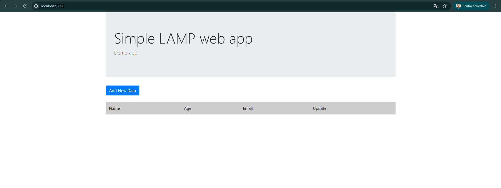
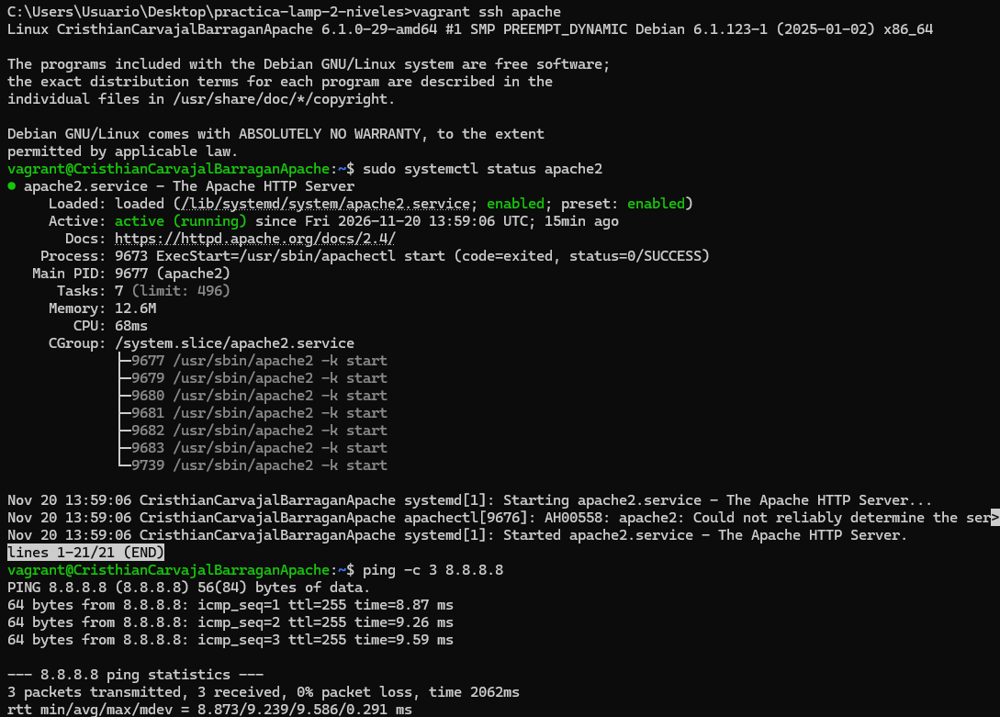
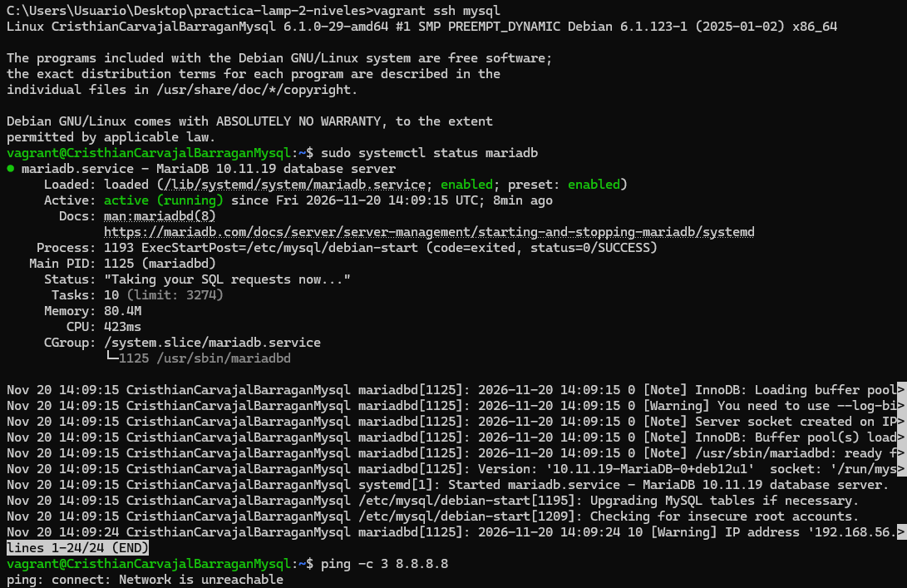
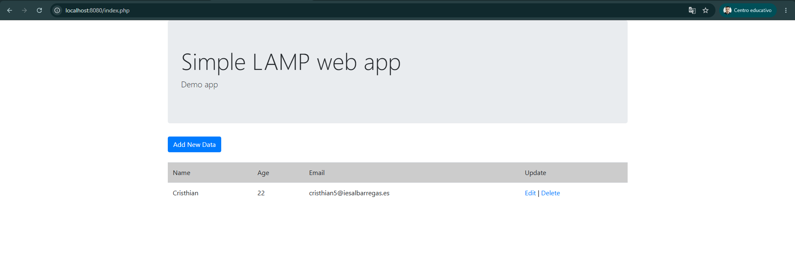

# Pila LAMP en dos niveles con Vagrant
###### Cristhian Carvajal Barragán

## 1. Arquitectura de la infraestructura

En esta práctica vamos a hacer una infraestructura web dividida en dos niveles usando **Vagrant** y el box oficial de **Debian 12 (`debian/bookworm64`)** sobre VirtualBox. Vamos a separar la capa de presentación o servidor web de la capa de datos o base de datos para mejorar la seguridad.

### _1.1. Estructura de las máquinas_

| Máquina | Hostname | Red privada | Acceso a Internet | Función |
| :--- | :--- | :--- | :--- | :--- |
| **Servidor Web** | `CristhianCarvajalApache` | `192.168.56.10` | Sí, mediante interfaz NAT | Ejecuta Apache y PHP. Recibe las peticiones del anfitrión mediante *Port Forwarding* `8080` -> `80`. |
| **Servidor BBDD** | `CristhianCarvajalMysql` | `192.168.56.20` | No, ruta por defecto eliminada | Ejecuta MariaDB. Aislada del exterior, solo acepta conexiones desde la IP de Apache. |

---

## 2. Configuración del entorno `Vagrantfile`

##### 1. Definición de las máquinas y redes en el `Vagrantfile`
- Para configurar las dos máquinas en un mismo proyecto, ponemos dos bloques `config.vm.define` dentro del `Vagrantfile`:
  - A la máquina **apache** le ponemos el hostname `CristhianCarvajalApache`, la IP (`192.168.56.10`) y el reenvío del puerto `80` al `8080` del equipo local.
  - A la máquina **mysql** le ponemos el hostname `CristhianCarvajalMysql` y la IP `192.168.56.20` dentro de la misma red para que los dos servidores puedan comunicarse entre sí.
  - Cada máquina tiene su propio script de aprovisionamiento en Bash mediante `path:`.

```ruby
# -*- mode: ruby -*-
# vi: set ft=ruby :

Vagrant.configure("2") do |config|
  config.vm.box = "debian/bookworm64"

  # Máquina 1: Servidor Web (Apache + PHP)
  config.vm.define "apache" do |apache|
    apache.vm.hostname = "CristhianCarvajalApache"
    apache.vm.network "private_network", ip: "192.168.56.10"
    apache.vm.network "forwarded_port", guest: 80, host: 8080
    apache.vm.provision "shell", path: "scripts/provision_apache.sh"
  end

  # Máquina 2: Servidor de Base de Datos (MariaDB)
  config.vm.define "mysql" do |mysql|
    mysql.vm.hostname = "CristhianCarvajalMysql"
    mysql.vm.network "private_network", ip: "192.168.56.20"
    mysql.vm.provision "shell", path: "scripts/provision_mysql.sh"
  end
end
```

---

## 3. Comprobaciones (Capturas)

##### 1. Comprobación de la app desde el navegador (Port Forwarding)


##### 2. Comprobación del servidor Apache y conexión a Internet


##### 3. Comprobación del servidor MySQL y el aislamiento de Internet


##### 4. Comprobación de nuevo usuario

